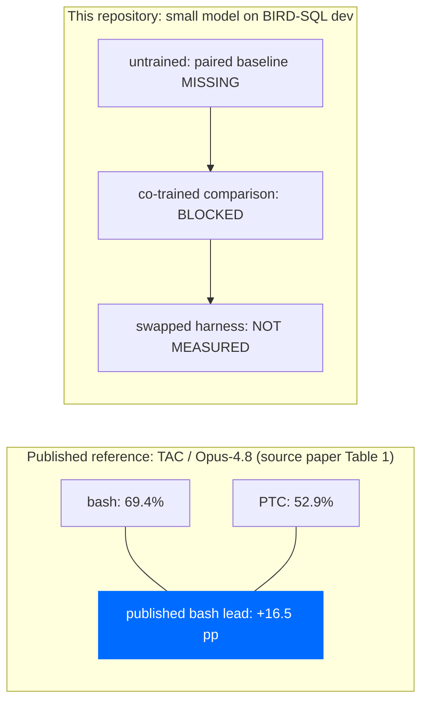

# co-train

Co-train tests whether training a small model around a tool interface improves
task performance, and whether any improvement survives a harness swap.

## Current orientation, 2026-10-30

Priority is the original research sequence **4 -> 5 -> 6**. Recent SQL
reuse/acceptance work was scope drift relative to that sequence: useful separate
engineering evidence, not completion of those research milestones.

### Current research milestones 4-6

| Stage | Current status and existing work | Remaining gap / next priority |
|---|---|---|
| 4: environment + escalation channel | **PARTIAL.** Opt-in reporting reaches both SQL arms, `PTCHarness.launch`, the task-bound SQL environment and the [production Bash fresh-subprocess route](docs/2026-10-31-bash-launch-reporting.md), fixture-verified before the next model action. [Episode v2 / capture v3](docs/2026-10-30-sql-reporting-evidence.md) bind configuration, sources and bounded telemetry; a controlled real-SQLite shortcut fixture exists. | Framework/CLI registration, isolated reporting transport/binding and actual TRL rollout/training integration remain. Bash activation requires paired task/harness bindings and `run_bash_qa`; unsupported skills/resumption refuse. Shell telemetry remains forgeable. |
| 5: two harnesses, measure untrained first | **PARTIAL.** Both bash/PTC SQL harnesses exist behind the [parity contract](docs/harness-parity.md). The [retired `ledger` premise check](docs/results-untrained.md) ran and did not reproduce the published gap. [`bench/prepare.py`](bench/prepare.py) now implements `freeze_draw` and `validate_draw` (create-only draw then gold supplement, independent retained-draw digest, identity checks, explicit fixture flags) per the [bench-preparation spec](spec/bench-preparation.md) — fixture-tested offline preparation, not a real corpus, baseline or measurement. The paired untrained baseline on the current BIRD taskset/frontier is **missing, not zero**. | Offline draw/validation preparation is implemented ([usage](docs/2026-10-31-bench-preparation.md), [readiness](docs/2026-10-30-baseline-readiness.md)); remaining gap is a real selected draw under disclosed bounds plus any authorized matched-G baseline rollouts — no policy, runtime or G is chosen and the frontier manifest stays absent. Match information, tools, budgets and metric before training; retain every planned task and distinguish error categories/invalid gold. |
| 6: co-train, then cross-harness evaluation | **BLOCKED, not complete.** [Training guards](train/guards.py) require the absent `bench/frontier/manifest.json`; the [main CLI](train/grpo_ptc.py) still raises `NotImplementedError` after real preflight. | Satisfy the existing gates unchanged — legitimate frontier measurements (a real manifest), compatible stack/template and completed/verified CLI integration — before preregistered training and cross-harness evaluation. Separate MLX updates do not establish this result. |

See [stage 4 reporting usage and evidence](docs/2026-10-30-agent-defect-escalation.md):
at `ae2323d` the recorded evidence is 813 targeted passes (14 launch-lifecycle
tests plus 799 existing), two controls that went RED and were restored, and no
full-suite rerun — increments are recorded separately, not as a post-feature suite.
The [reporting-evidence follow-on](docs/2026-10-30-sql-reporting-evidence.md)
records 3,393 existing and 170 new passes in separate runs, plus three
guard-bypass controls that failed and passed after restoration.
The 2026-10-31 [bench-preparation follow-on](docs/2026-10-31-bench-preparation.md)
records offline fixture evidence for `bench/prepare.py`: 239 affected tests
passed in 9.84s (98 new plus 141 existing), then 3 additional regressions
passed in 0.08s separately — 101 new unique cases total, not one 242-case
run. Three controls each went intended RED and were restored to 3 GREEN.
The [Bash launch follow-on](docs/2026-10-31-bash-launch-reporting.md) records
38 new passes (30 unit/lifecycle plus 8 real loopback subprocess integrations)
and 94 existing regressions in separate runs, plus actual forwarding
GREEN/RED/GREEN. No external model experiment or full-suite rerun.

The [frontier measurement source](bench/frontier/probe.py) and
[taskset contract](docs/bench-taskset.md) describe baseline preparation, not a
reason to stop stage 4 implementation. Preserve the original preregistered
negative `ledger` outcome; do not relabel it as current-taskset measurement or
a new reproduction. Existing preregistration/amendment gates still apply.

The historical “not started” rows below are dated history only. Use the
[current replacement table](#current-research-milestones-4-6), not those rows,
for stages 4-6; the original numbering and verdicts for stages 1-3 are retained.
The [native-training contract](spec/native-training.md) records stack/template
conflicts, not a fresh runtime check by this documentation update. Its historical
Mac/CUDA restriction is not a general claim that local MLX training is impossible.

### Separate recorded engineering evidence

| Workstream | Recorded boundary | Relation to the research sequence |
|---|---|---|
| SQL acceptance | Published code checkpoint `1501f0b`: earlier [direct-evaluator 19-job](docs/2026-10-29-bounded-native-acceptance.md) and [file-SDK 15-job](docs/2026-10-29-native-sql-skill-workflow.md) native campaigns passed CLOSED. The [portable helper](docs/2026-10-30-portable-sql-skill-sdk-acceptance.md) has recorded offline acceptance; its native phases remain NOT_EXECUTED. | Separate engineering, not stage 4-6 completion or full adversarial/kernel acceptance. Optional portable-native acceptance is off the critical path, not a stage 4 prerequisite. |
| Separate local MLX | Real sampling and weight updates were recorded in another worktree; no completed holdout/three-seed trial or harness-swap evaluation. See [recorded evidence](docs/evidence-index.md). | Partial training work, not stage 6 proof or measured learned benefit. |

Start with the [project map](docs/project-map.md), then the
[evidence index](docs/evidence-index.md). [HANDOFF.md](HANDOFF.md) preserves
dated technical history; a clone does not include original scratch receipts.
Recorded tests were not rerun for this status update.

This update grants no new experiment, native, model-spending or training
permission. Old 19/15-job authorizations are consumed, never replayable.
Preflight-only SQL context preparation is not new execution consent. Future
work follows its applicable authorization; paid model trials need an explicit
budget, and agent-session usage is not a product-experiment budget.
No learned benefit, savings or customer traction follows from these receipts.

## Historical implementation boundary, 2026-10-23

This dated checkpoint is retained for its native-training constraints and
validation receipt. It is not the latest SQL-pilot status and does not describe
the separate MLX workstream.

The historical "pipeline built" and install instructions below do not describe
a runnable native PTC training path. `train.native_training.build_sql_trainer`
now constructs an explicit-task native trainer behind the real preflight and
fresh installed-metadata checks. It never calls train/save; the main CLI still
refuses after preflight. Constructor tests prove wiring, not learning.

The frozen Transformers<5 contract conflicts with native TRL's >=5.2 requirement.
Local Transformers5.18 and datasets5 also exceed selected Unsloth metadata
bounds. The proposed 2026.10.3/1.13.0/5.17 core is metadata research, not an
approved installation recipe or verified CUDA runtime. The repository pins TRL;
Unsloth's selected PyPI requirement is a range, not that exact pin.
Automatic native-template selection also rejects the cached tokenizer's exact
template identity. A conditional rendering reference does not repair that.

The frontier manifest is still absent. No native model generation, optimizer
update or checkpoint restoration has been verified. See
[`spec/native-training.md`](spec/native-training.md) and
[`HANDOFF.md`](HANDOFF.md) for current evidence and blockers.
The latest default suite passed **1947 tests, one optional torch skip and two
tokenizer-control deselections**, in 204.38s with fresh isolated Hugging Face
caches and external networking denied. Local MCP loopback fixtures remain
allowed. Both explicit real-tokenizer controls passed separately with zero
skips. The preceding 1861-test warm-cache result is historical.
See [`spec/offline-harness-reliability.md`](spec/offline-harness-reliability.md)
and the [validation receipt](research/2026-10-23-offline-harness-reliability.json).

## Historical research framing

The framing below predates the separate MLX experiment. Statements about
unrun training and research-versus-product intent describe that earlier scope;
the current evidence boundary is above. Company positioning is not settled by
this historical text.

**Does co-training a small model against a programmatic-tool-calling (PTC) harness reverse the
bash-over-PTC ordering that arXiv 2609.11999 measured on untrained models — and does the winner
survive a harness swap?**

Both halves have published baselines. **Neither trained half has been run — but the untrained
premise check has, and it falsified the premise.** Across 14 measured runs on the now-retired
`ledger` taskset, 3 of them admissible, the bash-over-PTC gap did not reproduce: it inverted
(run 2h, PTC 14/14 against bash 12/14, not statistically separable at n=14). The durable
finding is cost rather than accuracy — 6.1 to 8.2x cost per solved task, quoted as a floor.
Full report in `docs/results-untrained.md`. A negative result is publishable and cheap, which
is the point: this is a falsification-first research repo, not a product.

**Related work, added 2026-10-18.** arXiv 2610.14774 (ProgAgent, submitted 2026-10-10) trains
Qwen3-8B and 14B under PTC, direct tool calling and a hybrid, and evaluates a harness swap:
PTC-training beats DTC-training under both interfaces. Its DTC arm is typed calls, not bash,
and its smallest model is 8B, so it answers the DTC analogue of this repo's question at 8B and
up, and does not enter the 0.6-1.7B band or the bash axis. `docs/related-work.md` maps H1-H5
and N1 against it cell by cell.

---

## Start here

Read the document that answers your question. The project map and evidence
index above distinguish current work from the dated research below.

| If you arrived asking | Read |
|---|---|
| **How is the project organized?** | [Project map](docs/project-map.md). |
| **What can an application honestly claim?** | [Evidence index](docs/evidence-index.md), including missing proof and local-only sources. |
| **What is the result?** | **`docs/results-untrained.md`** — the pre-committed report on the untrained premise check. Read it before the framing below on this page, which was written before the run. |
| **What went wrong with the instrument?** | **`docs/deviations.md`** — defect ledger at the top of the file, each fault with the observation that caught it and, where one exists, the run that exposed it. This line read "each fault with the run that exposed it" until 2026-10-13, when a third table arrived for the faults found while building the next instrument: no run could have exposed those, because it had not run yet. |
| **What is the state, and what is next?** | **`HANDOFF.md`** — current state first, then the dated history below it. |
| **How do I run the suite?** | [Quick start](#quick-start), below. **`.venv-ptc` is required** — the system interpreter cannot collect two of the suites. |
| **What was fixed before the run, so the result stays falsifiable?** | `docs/pre-registration.md` (append-only, owner-signed); every amendment to it is in `docs/deviations.md`. |
| **How does the PTC arm work? What are the tasks?** | `ptc/README.md` for the restricted runtime, `ledger/README.md` for the taskset. |
| **Why any of these choices?** | `research/README.md` — 8 synthesis documents + 6 deep lanes. |
| **Has anyone already answered this?** | **`docs/related-work.md`** — verified arXiv IDs, ProgAgent read in full against H1-H5 and N1, and the one cell still open. |
| **Did the training loop run on free hardware?** | `step2/results/README.md` for the verdict, `step2/README.md` for the detail. |



*Published motivation only, different cohorts: the 69.4/52.9/+16.5 pp cells are the
external TAC / Opus-4.8 reference recomputed from the source paper's Table 1
([pre-registration §3](docs/pre-registration.md)), not this repository's BIRD
baseline. The retired `ledger` premise check ran and did not reproduce the ordering;
the current BIRD paired baseline is still missing, so the untrained, co-trained and
swapped cells here are unmeasured — never zeros.*

Range to reverse is **+6.8 to +22.0 pp** across four published arms, one of which is not
statistically significant. Under a cost-per-successful-task metric the ordering is **already
reversed** in one untrained arm — so the metric is chosen before the run, not after.

---

## Historical build sequence

This original step sequence and its dated corrections are retained below.
Rows 1-3 keep their dated historical verdicts as originally recorded. Rows 4-6
originally read a bare "not started"; they were refreshed 2026-10-30 to match the
[current milestone table](#current-research-milestones-4-6) and are not a
remeasurement of the historical claims around them. Use the current orientation
above for the separate SQL and MLX checkpoints.

| Step | State | Where |
|---|---|---|
| **1 — adversarial non-solvers + the gate** | ✅ done, 51 tests | `src/cotrain/`, `tests/` |
| **2 — prove the loop on free hardware** | ✅ done — **`STEP 2 PASS`, fp16 stable on T4** | `step2/`, result in `step2/results/` |
| **3 — verifier before environment** | ✅ **built** — BIRD-SQL eval harness + co-training pipeline, probe run, gate shut | `bench/`, `train/` |
| 4 — environment + escalation channel | **PARTIAL**: both arms, launch/environment reporting, paired fresh-subprocess production Bash routing and source-bound episode v2/capture v3 exist; framework/CLI registration, isolated reporting and actual TRL integration remain | [Bash launch evidence](docs/2026-10-31-bash-launch-reporting.md), [reporting evidence](docs/2026-10-30-sql-reporting-evidence.md), [current table](#current-research-milestones-4-6) |
| 5 — two harnesses, measure untrained first | **PARTIAL** — both harnesses exist under the parity contract; `bench/prepare.py` freeze/validate draw preparation is fixture-tested offline; the BIRD paired untrained baseline is missing, not zero | [baseline readiness](docs/2026-10-30-baseline-readiness.md), [preparation usage](docs/2026-10-31-bench-preparation.md), [parity contract](docs/harness-parity.md) |
| 6 — co-train, then cross-harness eval | **BLOCKED** — guards require the absent `bench/frontier/manifest.json`; the main CLI still raises `NotImplementedError` after preflight | [`train/guards.py`](train/guards.py), [`train/grpo_ptc.py`](train/grpo_ptc.py) |

Step 2 is answered: **fp16 GRPO is stable on a Kaggle T4.** 5 steps, `grad_norm` finite and
positive throughout, `reward_std` > 0 every step, `kl` rising across three orders of magnitude —
a curve no public run had. Numbers, caveats and stack in `step2/results/`; re-checkable with no
GPU via `python step2/verdict.py step2/results/step2_metrics.jsonl`.

> **Step 3 is built.** The free path held — fp16 GRPO on Qwen3/T4 is stable, so rented Ampere is
> not required. PR #11 landed the BIRD-SQL eval harness and the co-training pipeline; PRs #12-#17
> followed with the probe and its defect fixes. `ledger` is retired and **BIRD-SQL dev is the
> taskset: 1534 questions over 277 fine clause-skeleton shapes** (25 coarse), against `ledger`'s 9.
>
> **The probe has run — free Kaggle T4, $0 — and what it produced were instrument defects rather
> than a result:** the defect ledger moved from 13 to 25, the most recent being `extract_sql`
> taking the *first* fenced block when the prompt's own fence shifts every pairing. The pipeline
> gate is still shut by design — `train/guards.py` requires a signed amendment, a per-task
> solve-rate band and `n_tasks >= 59` derived rather than stored, and
> `bench/frontier/manifest.json` does not exist, so `preflight()` raises. **No co-training run
> has started.** Note the other session argues in `docs/spike-verifiers.md`
> that the PTC arm should come before the verifier; reconcile the two orderings first.

**CORRECTED 2026-10-19. Read the paragraphs above for the framing, not for the current
state.** Three statements in them are stale:

- **"what it produced were instrument defects rather than a result"** was true of the runs
  before v9. v9 measured: generation and extraction worked (`clipped_ratio` 0.000,
  `grad_norm` 2.996e-06) and the run aborted at step 0 on four dead groups, which is a
  statement about the policy, not the pipeline. It produced no solve rate.
  `docs/probe-v9.md` is the record.
- **"the defect ledger moved from 13 to 25"** is stale whatever number replaces it: the count
  is whatever `docs/deviations.md`'s ledger currently derives (it read 33 on 2026-10-19 and
  another lane was editing it while this note was written, so this file states no number
  rather than a number that can drift). And `extract_sql` no longer
  takes the first fenced block: it takes the **last** SQL fence, fixed by `db37523` on
  2026-10-14, so the example given as "the most recent" is neither recent nor current.
- **the gate's requirements are still exactly as listed**, but the reason it is shut has
  narrowed: the signed amendment now exists (A8, signed 2026-10-12,
  `docs/pre-registration.md:376`). What is missing is the measured per-task band, because no
  run has produced one. `bench/frontier/manifest.json` is still absent and `preflight()`
  still raises.

---

## Quick start

**Use `.venv-ptc/bin/python`.** `ptc/` and `ledger/` import `verifiers`, which is pinned to a
commit rather than a tag (`69cc0f9` — see `HANDOFF.md` for why no released tag works) and is
**not** installed on the system interpreter. On system `python3` the suite does not fail
loudly at the end on a missing dependency; it dies during *collection*, so a careless reader
sees a count and not an error:

```
ERROR ptc/test_compare.py    - ModuleNotFoundError: No module named 'verifiers'
ERROR ledger/test_ledger.py  - ModuleNotFoundError: No module named 'verifiers'
```

No GPU is needed for the default suite. It covers `tests ptc ledger bench train`.
Its two real-tokenizer contamination controls are excluded by the default
`not tokenizer_integration` marker expression, not counted as passing.
Explicit integration requires a local directory matching the eight frozen
digests in `bench/tokenizer_artifact.json`. Admission precedes the Transformers
import; loading is local-only with remote code disabled. A missing path, changed
file or missing requested dependency fails rather than skips. No automatic
download or implicit cache lookup is provided.

The manifest freezes a contamination-test baseline only. It does not authenticate
upstream provenance, approve a model revision or fix native-template selection.
Symlink bytes are checked; filesystem immutability and TOCTOU protection are not
provided. Step 2 remains a separate legacy suite that may reach the HF hub.
Developed on CPython 3.12 and 3.14; no lower bound has actually been tested.

```bash
.venv-ptc/bin/python -m pytest -q
```

Optional local-tokenizer integration, requiring the admitted artifact:

```bash
.venv-ptc/bin/python -m pytest bench/test_contamination.py -q \
  -m tokenizer_integration --tokenizer-artifact /absolute/local/snapshot
```

The commands require an existing compatible environment; `.venv-ptc` is not
shipped in Git. They are not an installation recipe or authorization to fetch
dependencies. The legacy `step2` suite is separate and may contact Hugging Face;
it is not part of the default offline command.

### Historical suite notes, 2026-10-19 and earlier

The old command comments counted only `tests ptc ledger`, although default
collection already covered `tests ptc ledger bench train`. Counts below belong
to those earlier checkpoints.

A bare `pytest` is now safe to type: `pytest.ini`'s `testpaths` covers all three default
suites. It used to read `testpaths = tests`, so `pytest` collected 51 and silently skipped
`ptc` and `ledger` — the two suites that adjudicate the result. **Expect 528 passed** from the
default suite (measured 2026-10-14; it read 266 on 2026-10-10, before `bench` and `train`
landed); a sharply lower number means collection is being skipped again, which is a failure
this config has already had once.

**CORRECTED 2026-10-19: the three counts in the block above are stale.** Measured today with
`.venv-ptc/bin/python -m pytest`, in the repo venv:

| command | collected | result |
|---|---|---|
| `pytest -q` (default) | 588 | **587 passed, 1 skipped** |
| `pytest tests -q` | 58 | 58 passed |
| `pytest step2 -q` | 81 | 79 passed, 2 skipped |

So "528 passed", "51 tests" for Step 1 and "54 tests" for Step 2 all undercount; `testpaths`
also covers **five** suites now, `tests ptc ledger bench train`, not three. The stale numbers
are kept because this file's convention is to correct visibly. The Step 2 comments are still
right in substance: `step2/` is outside `testpaths` and its two skips are the
transformers/HF-hub-dependent tests, which is why it stays out of the default suite.

`step2/` is deliberately left out of `testpaths` so the default suite stays offline.

Step 2's own dev venv, if you want the tokenizer-dependent tests:

```bash
uv venv --python 3.12 .venv-tok
uv pip install --python .venv-tok/bin/python transformers tokenizers jinja2 pytest \
    accelerate datasets "trl==0.29.0"
```

That `trl` is for the dev-side template helpers only and is **not** the training pin — the Kaggle
stack is `trl==0.24.0` with `transformers<5`, for the reason in the constraints below.

**CORRECTED 2026-10-19:** the training pin sentence above names the Stack 2 pin, not the
probe's. The Kaggle probe stack is `unsloth==2026.10.3`, which pins `trl==1.13.0` with
`transformers>=4.56.2,<5` (`train/kaggle/probe.py:61`); `trl<=0.24.0` is what unsloth
installs *below* 2026.10.3, and that is the version where the four seams this project
needs are absent (`train/guards.py`, `docs/RUNBOOK-probe.md` §3.3). The `trl==0.29.0` above
is neither: it is the dev venv's, for template helpers only.

That historical GPU stack required Kaggle or rented hardware; prime-rl requires
NVIDIA. It does not describe the later, separate local MLX experiment.

---

## Repo map

| Path | What it is |
|---|---|
| **`HANDOFF.md`** | **Read this to continue the work.** Current state at the top; below the history marker, the original build sequence, hard constraints, the "do NOT do these" list and corpus map, kept as written. |
| `docs/project-map.md` | Current reading order, workstreams, directory map and checkout boundaries. |
| `docs/evidence-index.md` | Dated evidence, limitations and application-preparation gaps. |
| `spec/` | Current implementation contracts, pilot protocol and next-session handoff. |
| `bench/` | SQL tasks, execution scoring, harness comparisons and frontier controls. |
| `train/` | Training integration, capture/skill mechanics and gated SQL-pilot control. |
| `ptc/`, `ledger/` | Restricted PTC runtime and retired untrained-comparison taskset. |
| `docs/results-untrained.md` | The pre-committed report on the untrained premise check. |
| `docs/deviations.md` | Append-only amendment log, with the defect ledger at the top. |
| `docs/HANDOFF-STEP2.md` | What Step 1 learned, and the constraints it places on Steps 3-5. |
| `docs/pre-registration.md` | Outcomes fixed before the untrained run, so the result stays falsifiable. |
| `docs/licence-requests.md` | Drafted asks for the two unlicensed upstreams. |
| `docs/superpowers/` | Per-step specs and plans. |
| `research/` | 8 synthesis documents + 6 deep lanes. Start at `research/README.md`. |
| `src/cotrain/` | `src/cotrain/contract.py` (harness interface) · `src/cotrain/nonsolvers.py` (five adversarial non-solvers). |
| `tests/` | Step 1's gate. **`tests/leaky_env.py` is a permanent red-team target.** |
| `step2/` | Gate check, Kaggle run, pass criteria, mutation harness. See `step2/README.md`. |

---

## Two things that will bite you

**`tests/leaky_env.py` is deliberately exploitable and must never be hardened.** It carries one
leak per attack surface. If a future session "fixes" it, the gate stops discriminating and still
reports green.

**A green check is not evidence.** Four separate defects on this project were the same shape: a
passing check running against a stale, fake, or dormant target — two of them inside the
verification tooling itself. So the convention here is to **mutate the target and confirm red**
before trusting green. Both test suites are mutation-tested:

| Suite | Tests | Mutation testing |
|---|---|---|
| Step 1 gate | 51 | Six rounds; each found what the last missed — 5 surviving mutants in the contract, 4 in the agents, 3 dormant guards in the gate, then a whole exploit class. Total mutants run was not recorded. |
| Step 2 | 73 | 59 mutants, 0 survivors, re-run against the final code state. |

**Dated note, 2026-10-19:** the two "Tests" cells are the counts at the mutation rounds, not
now. `pytest tests -q` collects **58** and `pytest step2 -q` collects **81** (79 passed, 2
skipped) today. The mutation results themselves are unaffected: neither suite has been
re-mutated since those counts were taken, so a reader should treat the rows as evidence for
the round they describe, not for the current files.

`step2/mutate.py` is the harness — fresh copy per mutation and `PYTHONDONTWRITEBYTECODE=1`, both
mandatory. A byte-length-identical mutation restored within the same second leaves identical mtime
*and* size, so Python keeps executing the cached `.pyc`. That produced one false verdict here.

---

## Historical GPU-stack constraints

These constraints describe the original GPU path. Current SQL permissions are
in its handoff; separate MLX limits are in that track's continuation document.

Expensive to rediscover. Full table in `HANDOFF.md`.

- **No local training on this GPU stack.** darwin/arm64 dev machine; separate MLX work is not this stack.
- **T4 = fp16 only.** Compute capability 7.5; bf16 needs 8.0.
- **prime-rl cannot run on a T4 at all** — no float16 in its `DTYPE_MAP`, FSDP hardcoded to
  bfloat16. The Unsloth-on-T4 path and the prime-rl path are *disjoint*, not two rungs of a ladder.
- **Unsloth pins `trl<=0.24.0`**, and TRL 0.24 declares `transformers>=4.56.1` with no upper
  bound. Install `transformers<5` or `from trl import GRPOTrainer` dies on an unrelated module —
  see `step2/README.md` for the mechanism.
- **Kaggle reality:** 30 GPU-h/week, 12 h/session, 20-30 min idle timeout.

---

## Local checkout snapshot, 2026-10-27

| Branch | Holds |
|---|---|
| `fix/nonfinite-dead-group-monitor` | SQL-pilot checkpoint, last saved handoff `6bda2ac` before this cleanup. Local work, not a claim about GitHub state. |
| `docs/mlx-three-seed-handoff-2026-10-25` | Separate MLX continuation, `8c877fd`, in its own local worktree. Not merged here. |

This is not a complete branch inventory. Verify status/log before continuing;
do not assume `main` contains these checkpoints.

### Historical branch cleanup, 2026-10-11

Six branches were deleted 2026-10-11 after `git rev-list main..<branch>` showed zero unique
commits on each: `step1-nonsolver-gate`, `step2-kaggle-smoke`, `step2-run`,
`fix/ptc-instrument-defects`, `docs/settle-step3-ordering`,
`fix/ptc-real-mode-control-and-error-exit`. Every commit they held is an ancestor of `main`.
This table previously described two of them as holding work `main` lacked, which stopped being
true when they merged and was never corrected.

Two sessions have worked this repo concurrently. If you run more than one, **give each its own
`git worktree`** — a shared checkout already caused one branch switch under a live session and one
contaminated commit.
